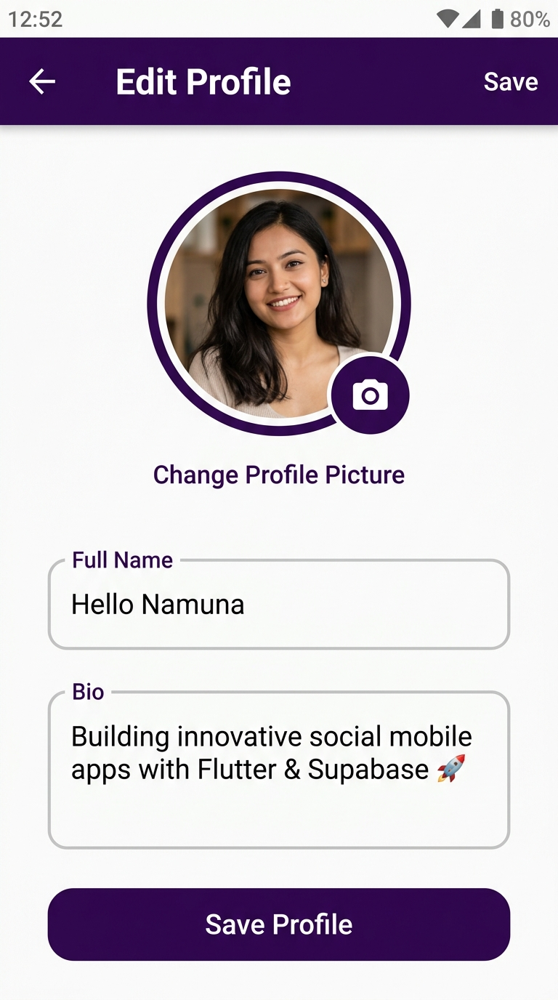

# 📱 SocialApp — Flutter & Supabase

A modern, high-performance social networking mobile application built with **Flutter** and powered by **Supabase**.

---

## 📸 Screenshots

| Feed & Posts | User Profile | Edit Profile |
|:---:|:---:|:---:|
|  |  |  |

---

## ✨ Features

- **🏠 Interactive Feed**:
  - Browse user posts with relative timestamps, author avatars, and rich media.
  - Pull-to-refresh feed and smooth pagination.
  - Interactive image preview with zoom and pan gestures.
- **❤️ Like System**:
  - Double-tap post image to trigger burst heart animation and haptic feedback.
  - Realtime like count updates.
  - Bottom sheet viewer showing everyone who liked a post.
- **💬 Realtime Comments**:
  - Live comment synchronization via Supabase Realtime Postgres Changes.
  - Comment deletion for comment owners.
  - Bottom sheet modal for reading and submitting comments.
- **👤 User Profile & Profile Viewer**:
  - **My Profile**: View your avatar, full name, email, bio, join date, post count, and total likes received.
  - **Other User Profile Viewer**: Tap on any author, commenter, or liker's avatar/name to inspect their profile and authored posts.
  - Dual view modes: toggle between full **Feed View** and 3-column **Grid View** of posts.
- **✏️ Profile Editing**:
  - Upload avatar pictures from Gallery or Camera directly to Supabase Storage (`social_files`).
  - Option to remove current avatar picture.
  - Update display name and bio with client-side character validation.
  - Automatic synchronization with Supabase Auth metadata.
- **🔐 Authentication**:
  - Secure email & password sign-up and sign-in.
  - Automatic profile creation via database triggers upon user registration.

---

## 🗂️ Project Structure

```text
lib/
├── main.dart                       # App entry point & Supabase initialization
├── pages/
│   ├── home_page.dart              # Main social feed page
│   ├── post_create_page.dart       # Post creator with image upload
│   ├── profile_page.dart           # Owner profile & other user profile viewer
│   ├── edit_profile_page.dart      # Edit name, bio, and avatar photo
│   ├── sign_in_page.dart           # User login page
│   └── sign_up.dart                # Account registration page
├── utils/
│   └── app_utils.dart              # Storage URL resolver, time ago, initials
└── widgets/
    ├── navigation_bar.dart         # Curved bottom navigation bar
    ├── post_card.dart              # Social post card with interactive actions
    ├── comments_sheet.dart         # Realtime comments modal sheet
    ├── likes_sheet.dart            # Likers list bottom sheet
    └── custom_text_field.dart      # Standardized text form input
```

---

## 🚀 Getting Started

### 1. Prerequisites
- [Flutter SDK](https://flutter.dev/docs/get-started/install) (>= 3.13.4)
- A [Supabase](https://supabase.com) account and project

### 2. Configure Credentials
Update `lib/main.dart` with your Supabase URL and Publishable Key:

```dart
await Supabase.initialize(
  url: 'YOUR_SUPABASE_PROJECT_URL',
  publishableKey: 'YOUR_SUPABASE_PUBLISHABLE_KEY',
);
```

### 3. Run the App
```bash
flutter pub get
flutter run
```

---

## 🗄️ Supabase Complete Database Setup (Single SQL Script)

Copy and run the following SQL script directly in the **Supabase SQL Editor** (`Dashboard > SQL Editor > New query`). It sets up all tables, foreign keys, triggers, Row Level Security (RLS) policies, storage buckets, and realtime publication:

```sql
-- ============================================================================
-- FULL SUPABASE SCHEMA & CONFIGURATION SCRIPT FOR SOCIAL APP
-- ============================================================================

-- 1. EXTENSIONS
CREATE EXTENSION IF NOT EXISTS "uuid-ossp";
CREATE EXTENSION IF NOT EXISTS "pgcrypto";

-- 2. PUBLIC TABLES

-- PROFILES TABLE
CREATE TABLE IF NOT EXISTS public.profiles (
    id UUID PRIMARY KEY REFERENCES auth.users(id) ON DELETE CASCADE DEFAULT auth.uid(),
    full_name VARCHAR NOT NULL,
    bio TEXT,
    image_url VARCHAR,
    created_at TIMESTAMP WITH TIME ZONE NOT NULL DEFAULT now()
);

-- POSTS TABLE
CREATE TABLE IF NOT EXISTS public.posts (
    id UUID PRIMARY KEY DEFAULT gen_random_uuid(),
    content TEXT NOT NULL,
    image_url VARCHAR,
    user_id UUID NOT NULL REFERENCES public.profiles(id) ON DELETE CASCADE DEFAULT auth.uid(),
    created_at TIMESTAMP WITH TIME ZONE NOT NULL DEFAULT now()
);

-- LIKES TABLE
CREATE TABLE IF NOT EXISTS public.likes (
    id UUID PRIMARY KEY DEFAULT gen_random_uuid(),
    post_id UUID NOT NULL REFERENCES public.posts(id) ON DELETE CASCADE,
    user_id UUID NOT NULL REFERENCES public.profiles(id) ON DELETE CASCADE DEFAULT auth.uid(),
    created_at TIMESTAMP WITH TIME ZONE NOT NULL DEFAULT now(),
    CONSTRAINT likes_post_user_unique UNIQUE (post_id, user_id)
);

-- COMMENTS TABLE
CREATE TABLE IF NOT EXISTS public.comments (
    id UUID PRIMARY KEY DEFAULT gen_random_uuid(),
    post_id UUID NOT NULL REFERENCES public.posts(id) ON DELETE CASCADE,
    user_id UUID NOT NULL REFERENCES public.profiles(id) ON DELETE CASCADE DEFAULT auth.uid(),
    content TEXT NOT NULL,
    created_at TIMESTAMP WITH TIME ZONE NOT NULL DEFAULT now()
);

-- 3. AUTOMATIC PROFILE CREATION TRIGGER ON USER SIGNUP
CREATE OR REPLACE FUNCTION public.handle_new_user()
RETURNS TRIGGER
LANGUAGE plpgsql
SECURITY DEFINER
SET search_path = public
AS $$
BEGIN
    INSERT INTO public.profiles (id, full_name)
    VALUES (
        new.id,
        COALESCE(new.raw_user_meta_data ->> 'full_name', 'Anonymous User')
    )
    ON CONFLICT (id) DO UPDATE
    SET full_name = EXCLUDED.full_name;

    RETURN new;
END;
$$;

DROP TRIGGER IF EXISTS on_auth_user_created ON auth.users;
CREATE TRIGGER on_auth_user_created
    AFTER INSERT ON auth.users
    FOR EACH ROW EXECUTE FUNCTION public.handle_new_user();

-- 4. ROW LEVEL SECURITY (RLS) ACTIVATION
ALTER TABLE public.profiles ENABLE ROW LEVEL SECURITY;
ALTER TABLE public.posts ENABLE ROW LEVEL SECURITY;
ALTER TABLE public.likes ENABLE ROW LEVEL SECURITY;
ALTER TABLE public.comments ENABLE ROW LEVEL SECURITY;

-- 5. RLS POLICIES

-- PROFILES POLICIES
DROP POLICY IF EXISTS "Enable read access for all users" ON public.profiles;
CREATE POLICY "Enable read access for all users"
    ON public.profiles FOR SELECT
    TO public
    USING (true);

DROP POLICY IF EXISTS "Enable insert for users based on user_id" ON public.profiles;
CREATE POLICY "Enable insert for users based on user_id"
    ON public.profiles FOR INSERT
    TO public
    WITH CHECK ((SELECT auth.uid()) = id);

DROP POLICY IF EXISTS "Enable update for users based on user_id" ON public.profiles;
CREATE POLICY "Enable update for users based on user_id"
    ON public.profiles FOR UPDATE
    TO authenticated
    USING ((SELECT auth.uid()) = id)
    WITH CHECK ((SELECT auth.uid()) = id);

-- POSTS POLICIES
DROP POLICY IF EXISTS "Enable read access for all users" ON public.posts;
CREATE POLICY "Enable read access for all users"
    ON public.posts FOR SELECT
    TO public
    USING (true);

DROP POLICY IF EXISTS "Enable insert for users based on user_id" ON public.posts;
CREATE POLICY "Enable insert for users based on user_id"
    ON public.posts FOR INSERT
    TO public
    WITH CHECK ((SELECT auth.uid()) = user_id);

DROP POLICY IF EXISTS "Enable update for users based on user_id" ON public.posts;
CREATE POLICY "Enable update for users based on user_id"
    ON public.posts FOR UPDATE
    TO authenticated
    USING ((SELECT auth.uid()) = user_id)
    WITH CHECK ((SELECT auth.uid()) = user_id);

DROP POLICY IF EXISTS "Enable delete for users based on user_id" ON public.posts;
CREATE POLICY "Enable delete for users based on user_id"
    ON public.posts FOR DELETE
    TO authenticated
    USING ((SELECT auth.uid()) = user_id);

-- LIKES POLICIES
DROP POLICY IF EXISTS "Enable read access for all users" ON public.likes;
CREATE POLICY "Enable read access for all users"
    ON public.likes FOR SELECT
    TO public
    USING (true);

DROP POLICY IF EXISTS "Enable insert for users based on user_id" ON public.likes;
CREATE POLICY "Enable insert for users based on user_id"
    ON public.likes FOR INSERT
    TO public
    WITH CHECK ((SELECT auth.uid()) = user_id);

DROP POLICY IF EXISTS "Enable delete for users based on user_id" ON public.likes;
CREATE POLICY "Enable delete for users based on user_id"
    ON public.likes FOR DELETE
    TO public
    USING ((SELECT auth.uid()) = user_id);

-- COMMENTS POLICIES
DROP POLICY IF EXISTS "Enable read access for all users" ON public.comments;
CREATE POLICY "Enable read access for all users"
    ON public.comments FOR SELECT
    TO public
    USING (true);

DROP POLICY IF EXISTS "Enable insert for users based on user_id" ON public.comments;
CREATE POLICY "Enable insert for users based on user_id"
    ON public.comments FOR INSERT
    TO public
    WITH CHECK ((SELECT auth.uid()) = user_id);

DROP POLICY IF EXISTS "Enable delete for users based on user_id" ON public.comments;
CREATE POLICY "Enable delete for users based on user_id"
    ON public.comments FOR DELETE
    TO public
    USING ((SELECT auth.uid()) = user_id);

-- 6. STORAGE BUCKET CONFIGURATION
INSERT INTO storage.buckets (id, name, public, file_size_limit, allowed_mime_types)
VALUES (
    'social_files',
    'social_files',
    true,
    52428800, -- 50 MB
    ARRAY['image/jpeg', 'image/png', 'image/webp', 'image/gif']
)
ON CONFLICT (id) DO UPDATE SET
    public = true,
    file_size_limit = 52428800,
    allowed_mime_types = ARRAY['image/jpeg', 'image/png', 'image/webp', 'image/gif'];

-- 7. STORAGE POLICIES
DROP POLICY IF EXISTS "Public can view social_files" ON storage.objects;
CREATE POLICY "Public can view social_files"
    ON storage.objects FOR SELECT
    TO public
    USING (bucket_id = 'social_files');

DROP POLICY IF EXISTS "authenticated user can do anything 18w6ucl_0" ON storage.objects;
DROP POLICY IF EXISTS "authenticated user can do anything 18w6ucl_1" ON storage.objects;
DROP POLICY IF EXISTS "authenticated user can do anything 18w6ucl_2" ON storage.objects;
DROP POLICY IF EXISTS "authenticated user can do anything 18w6ucl_3" ON storage.objects;
DROP POLICY IF EXISTS "Authenticated can insert social_files" ON storage.objects;
DROP POLICY IF EXISTS "Authenticated can update social_files" ON storage.objects;
DROP POLICY IF EXISTS "Authenticated can delete social_files" ON storage.objects;

CREATE POLICY "Authenticated can insert social_files"
    ON storage.objects FOR INSERT
    TO authenticated
    WITH CHECK (bucket_id = 'social_files');

CREATE POLICY "Authenticated can update social_files"
    ON storage.objects FOR UPDATE
    TO authenticated
    USING (bucket_id = 'social_files');

CREATE POLICY "Authenticated can delete social_files"
    ON storage.objects FOR DELETE
    TO authenticated
    USING (bucket_id = 'social_files');

-- 8. REALTIME REPLICATION SETUP
DO $$
BEGIN
    IF NOT EXISTS (
        SELECT 1 FROM pg_publication_tables 
        WHERE pubname = 'supabase_realtime' AND schemaname = 'public' AND tablename = 'posts'
    ) THEN
        ALTER PUBLICATION supabase_realtime ADD TABLE public.posts;
    END IF;

    IF NOT EXISTS (
        SELECT 1 FROM pg_publication_tables 
        WHERE pubname = 'supabase_realtime' AND schemaname = 'public' AND tablename = 'likes'
    ) THEN
        ALTER PUBLICATION supabase_realtime ADD TABLE public.likes;
    END IF;

    IF NOT EXISTS (
        SELECT 1 FROM pg_publication_tables 
        WHERE pubname = 'supabase_realtime' AND schemaname = 'public' AND tablename = 'comments'
    ) THEN
        ALTER PUBLICATION supabase_realtime ADD TABLE public.comments;
    END IF;
END $$;
```

---

## 🧪 Testing

To run the unit tests:

```bash
flutter test test/app_utils_test.dart test/profile_test.dart
```
